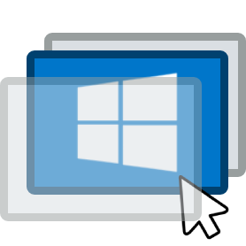

<div align="center">
  
  <h1>WindowAssist</h1>
  <p><strong>Lightweight workspace manager, window orchestrator, and interactive overview for Windows</strong></p>

  <p>
    
    
    
    
  </p>
</div>

---

**WindowAssist** enhances window management on Windows by introducing virtual workspaces, a quick-access scratchpad ("Pocket"), auto-hiding title bars, and effortless mouse-driven window controls without heavy background overhead.

---

## Features

### Virtual Workspaces (Multi-Monitor)
* **Per-Display Spaces:** Independent workspaces for each connected monitor with configurable limits.
* **Instant Switching:** Seamless, flicker-free desktop transitions.
* **State Recovery:** Preserves window layouts, coordinates, and maximizations across reloads.
* **Minimalist HUD:** Clean on-screen display (OSD) showing the active workspace number.

### Interactive Overview
* **Visual Canvas:** Mission Control / Expo style grid rendering all workspaces and running windows.
* **Drag-and-Drop:** Move single or multiple windows between workspaces effortlessly.
* **Live Previews:** Instant thumbnail previews on hover and high-resolution window icons.
* **Jump List Menu:** Right-click context actions (maximize, minimize, center, close).
* **Adaptive Width:** Resizable overview container with persistent width preferences.

### The Pocket (Scratchpad)
* **Global Access:** Stash temporary, floating, or priority applications outside regular workspaces.
* **Always Available:** Quick access to stashed windows across any active desktop.
* **Visual Frame:** Subtle, customizable outline border for pocketed windows.
* **Fast Navigation:** Dedicated shortcuts to cycle through or summon/hide the entire pocket.

### Mouse Controls & Layer Peeker
* **Move Anywhere:** Hold the modifier key and drag <kbd>LButton</kbd> anywhere inside a window to move it.
* **Resize Anywhere:** Hold the modifier key and drag <kbd>RButton</kbd> anywhere inside a window to resize it.
* **Layer Peeker:** Click without dragging to bring obscured overlapping windows forward without disrupting desktop order.
* **Window Pinning:** Pin floating windows on top of all other maximized applications.

### Auto-Hiding Title Bars
* **Maximized Space:** Automatically hides window captions to maximize usable screen real estate.
* **Edge Trigger:** Smoothly reveals title bars when hovering near the top edge.
* **Dark Theme:** Applies dark header styling to native Windows caption bars.
* **Smart Detection:** Automatically ignores games, browsers, and custom client frames.

### Cross-Workspace Alt+Tab
* **Unified Switcher:** Replaces native task switching with a clean, workspace-aware switcher.
* **MRU Ordering:** Prioritizes windows by most recent usage across all desktops.
* **Badge Indicators:** Distinct workspace labels on each app card.

### Settings & Keybinding Profiles
* **Modern Settings GUI:** Embedded web interface with instant setting application.
* **Multiple Profiles:** Create, duplicate, rename, or restore custom keybinding schemes.
* **Interactive Recorder:** Capture keyboard shortcuts, mouse buttons, and wheel triggers.
* **Localization:** Available in English and Russian.

---

## Default Shortcuts

WindowAssist uses <kbd>NumLock</kbd> as its default modifier key to prevent collisions with built-in Windows shortcuts.

| Action | Shortcut |
| :--- | :--- |
| **Overview Canvas** | <kbd>NumLock</kbd> + <kbd>Tab</kbd> *or* <kbd>NumLock</kbd> + <kbd>Space</kbd> |
| **Switch Workspace (1–9)** | <kbd>NumLock</kbd> + <kbd>1</kbd>…<kbd>9</kbd> |
| **Move Window to Workspace (1–9)** | <kbd>NumLock</kbd> + <kbd>Shift</kbd> + <kbd>1</kbd>…<kbd>9</kbd> |
| **Previous / Next Workspace** | <kbd>NumLock</kbd> + <kbd>Z</kbd> / <kbd>X</kbd> *(or <kbd>WheelUp</kbd> / <kbd>WheelDown</kbd>)* |
| **Move Window Anywhere** | Hold <kbd>NumLock</kbd> + Drag <kbd>LButton</kbd> |
| **Resize Window Anywhere** | Hold <kbd>NumLock</kbd> + Drag <kbd>RButton</kbd> |
| **Layer Peeker (Cycle overlapping)** | <kbd>NumLock</kbd> + Click <kbd>LButton</kbd> |
| **Pin Floating Windows on Top** | <kbd>NumLock</kbd> + Click <kbd>RButton</kbd> |
| **Add / Remove Window to Pocket** | <kbd>NumLock</kbd> + <kbd>C</kbd> |
| **Cycle Pocket Windows** | <kbd>NumLock</kbd> + <kbd>F</kbd> |
| **Summon / Hide Pocket** | <kbd>NumLock</kbd> + <kbd>MButton</kbd> |
| **Cross-Workspace Alt+Tab** | <kbd>Alt</kbd> + <kbd>Tab</kbd> |
| **Close Active Window** | <kbd>NumLock</kbd> + <kbd>Q</kbd> |
| **Minimize Active Window** | <kbd>NumLock</kbd> + <kbd>A</kbd> |
| **Open Settings** | <kbd>NumLock</kbd> + <kbd>I</kbd> |
| **Quick Reload** | <kbd>NumLock</kbd> + <kbd>Ctrl</kbd> + <kbd>R</kbd> |
| **Emergency Panic Exit** | <kbd>NumLock</kbd> + <kbd>Insert</kbd> |

> All shortcuts can be modified or assigned to different profiles in the Settings window (<kbd>NumLock</kbd> + <kbd>I</kbd>).

---

## Requirements

* **Operating System:** Windows 10 (version 1809+) or Windows 11 (64-bit).
* **Runtime:** Microsoft Edge WebView2 Runtime (pre-installed on Windows 11 and up-to-date Windows 10 systems).
* **AutoHotkey:** [AutoHotkey v2.0+](https://www.autohotkey.com/) *(required only when running directly from source)*.
* **Privileges:** Administrator privileges are recommended so window hooks can interact with elevated processes (e.g. Task Manager, terminal emulators).

---

## Installation & Running

### Running from Source
1. Clone the repository:
   ```bash
   git clone https://github.com/DOBOFood/WindowAssist.git
   cd WindowAssist
   ```
2. Run `WindowAssist.ahk` using AutoHotkey v2.

### Building Standalone Executable
Run `build.bat` in the root folder. It will compile the application into a standalone portable binary inside `dist/`:
```cmd
build.bat
```

---

## Configuration

Settings are stored in `config.json` in the root directory. Changes made via the settings interface are saved and applied in real time.

If `config.json` is missing or corrupted, WindowAssist automatically generates a clean default configuration on launch.

---

## License

This project is licensed under the MIT License. See the [LICENSE](LICENSE) file for details.