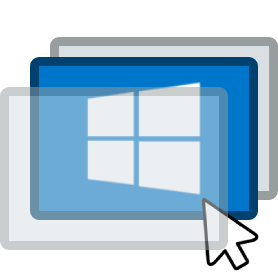

<div align="center">
  
  <h1>WindowAssist</h1>
  <p><strong>Windows multitasking that actually feels fast — per-monitor desktops, a drag-and-drop overview, a floating scratchpad, and AltSnap mouse controls.</strong></p>

  <p>
    <a href="https://github.com/DOBOFood/WindowAssist/releases/latest"></a>
    
    
    
    <a href="LICENSE"></a>
  </p>

  <p>
    <a href="https://github.com/DOBOFood/WindowAssist/releases/latest"><strong>⬇ Download Portable ZIP</strong></a> •
    <a href="#why-not-just-windows--tiling-wms">Why WindowAssist?</a> •
    <a href="#what-it-does">Features</a> •
    <a href="#cheat-sheet">Shortcuts</a> •
    <a href="#install">Install</a>
  </p>
</div>

---

Native Windows virtual desktops switch **every monitor at once** with sluggish animations, moving windows means sniping tiny title bars, and your terminal or notes always get buried under a maximized browser.

**WindowAssist** brings Linux/macOS-grade speed to Windows 10 & 11 **without forcing your windows into a rigid tiling grid**. Keep your floating windows, games, and muscle memory—just make everything instantaneous.

### Why not just Windows / Tiling WMs?

| | Native Windows | Komorebi / GlazeWM | **WindowAssist** |
| :--- | :---: | :---: | :---: |
| **Desktop switching speed** | Slow animation | Instant | **< 1 ms, zero animation** |
| **Per-monitor isolation** | ❌ Switches all monitors | ✅ | ✅ **Up to 9 per monitor** |
| **Keep floating windows & games intact** | ✅ | ❌ Forces tiling | ✅ **Floating-first** |
| **Drag & resize from anywhere in a window** | ❌ | ⚠️ | ✅ **+ Native Aero Snap** |
| **Visual Overview + global scratchpad** | ⚠️ Basic `Win+Tab` | ❌ | ✅ **Drag-and-drop + Pocket** |
| **Setup & config** | Built-in | YAML / CLI | ✅ **Live GUI (12 languages)** |

---

## What It Does

### 1. Instant Per-Monitor Virtual Desktops
Zero animations, zero delay. Switching to Desktop 3 on your main screen leaves your docs or video untouched on your second monitor. Hold <kbd>NumLock</kbd> + <kbd>Shift</kbd> to highlight the active window with a pulsing border and carry it with you as you switch.

* **Crisp GDI+ OSD badge:** Shows your desktop number or pin icon—customizable position, colors, opacity, and corner radius.
* **Crash-safe recovery:** Saves window positions in `state.json` and Win32 props; nothing stays stranded off-screen when you exit.

### 2. Visual Overview Canvas
Hit <kbd>NumLock</kbd> + <kbd>Tab</kbd> (or <kbd>Space</kbd>) for a full-screen, WebView2-powered canvas of every workspace on the active monitor.

* **Drag & drop in bulk:** <kbd>Ctrl</kbd>-click multiple windows and drop them onto another desktop or straight into **The Pocket**.
* **Live hover previews:** Hover any card to peek at the real window without switching desktops.
* **Quick actions:** Right-click to center (70%), maximize, minimize, or close; middle-click any app to close it, or any workspace to remove it.
* **5 visual themes:** *Classic, Frosted Glass, Minimal, Compact, High Contrast*—with custom corner radius, opacity, and resizable width.

### 3. The Pocket — Your Global Scratchpad
Stash any app into **The Pocket** (<kbd>NumLock</kbd> + <kbd>C</kbd>) to detach it from individual desktops. Summon or hide it over any workspace with <kbd>NumLock</kbd> + <kbd>MButton</kbd>, or cycle through pocketed tools with <kbd>NumLock</kbd> + <kbd>F</kbd>.

* **Smart 50% auto-dim:** Click the window behind your Pocket app and it automatically fades to 50% opacity so you can read or type underneath. Click back and it snaps to 100%.
* **Built for utilities:** Terminals, AI chats, calculators, Telegram, or quick notes—always one click away, framed with a custom accent border.

### 4. Grab & Resize Anywhere (+ Aero Snap)
Stop hunting for 1-pixel borders. Hold <kbd>NumLock</kbd> anywhere inside a window:

* **Drag <kbd>LButton</kbd>:** Move any window from anywhere inside it (even pulls maximized windows smoothly under your cursor).
* **Drag <kbd>RButton</kbd>:** Smart 9-zone resize from the closest edge or corner.
* **Snap Preview + Native Aero Snap:** Drag to a screen edge or corner to see a live highlight and snap into halves, quarters, or fullscreen.
* **Keyboard precision:** Nudge with <kbd>NumLock</kbd> + <kbd>Arrows</kbd>, resize with <kbd>NumLock</kbd> + <kbd>Alt</kbd> + <kbd>Arrows</kbd>.

### 5. Layer Peeker & Pin Floating Windows
* **Layer Peeker (<kbd>NumLock</kbd> + Click <kbd>LButton</kbd>):** Surface the window directly beneath your cursor without moving anything. Keep clicking in the same spot to cycle through the entire Z-order stack.
* **Pin on Top (<kbd>NumLock</kbd> + Click <kbd>RButton</kbd> / <kbd>E</kbd>):** Keep floating players, timers, or notes pinned above maximized apps on the active workspace.

### 6. Auto-Hiding Title Bars & Cross-Desktop Alt+Tab
* **Title Bar Auto-Hide:** Hide standard Win32 title bars for extra vertical space and reveal them on top-edge hover, with forced DWM dark captions (games, browsers, and custom frames are safely ignored).
* **Cross-Desktop Alt+Tab:** Clean MRU switcher with `WS 1`, `WS 2` badges—release <kbd>Alt</kbd> or click a card to jump straight to that desktop and window.
* **Minimal Taskbar Mode:** Optional toggle in Settings to hide the running task list for a distraction-free taskbar.

### 7. Live Settings UI (No Config-File Pain)
Press <kbd>NumLock</kbd> + <kbd>I</kbd> to customize everything in real time:

* **No `NumLock` on your keyboard?** Swap the primary modifier to <kbd>CapsLock</kbd>, <kbd>Alt</kbd>, <kbd>Win</kbd>, or any key across all bindings in **one click**.
* **Interactive key recorder:** Bind keys, mouse buttons, or scroll wheels with live conflict warnings and multiple profiles.
* **Zero-UAC autostart:** Optional Task Scheduler startup with admin rights—no UAC prompt at login.
* **12 languages & JSON backup:** English, Russian, Chinese (Simplified), Spanish, German, French, Portuguese (BR), Japanese, Korean, Italian, Polish, and Turkish. Export/import everything anytime.

---

## Cheat Sheet

*Every shortcut is remappable in Settings (<kbd>NumLock</kbd> + <kbd>I</kbd>).*

| Action | Shortcut |
| :--- | :--- |
| **Overview Canvas** | <kbd>NumLock</kbd> + <kbd>Tab</kbd> *or* <kbd>Space</kbd> |
| **Switch Desktop (1–9)** | <kbd>NumLock</kbd> + <kbd>1</kbd>…<kbd>9</kbd> |
| **Carry Window to Desktop (1–9)** | <kbd>NumLock</kbd> + <kbd>Shift</kbd> + <kbd>1</kbd>…<kbd>9</kbd> |
| **Prev / Next Desktop** | <kbd>NumLock</kbd> + <kbd>Z</kbd> / <kbd>X</kbd> *(or <kbd>WheelUp</kbd> / <kbd>WheelDown</kbd>)* |
| **Move / Resize Window (Mouse)** | Hold <kbd>NumLock</kbd> + Drag <kbd>LButton</kbd> / <kbd>RButton</kbd> |
| **Move / Resize Window (Keys)** | <kbd>NumLock</kbd> + <kbd>Arrows</kbd> / <kbd>NumLock</kbd> + <kbd>Alt</kbd> + <kbd>Arrows</kbd> |
| **Layer Peeker / Pin Floating** | Hold <kbd>NumLock</kbd> + Click <kbd>LButton</kbd> / <kbd>RButton</kbd> *(or <kbd>E</kbd>)* |
| **Pocket: Add / Cycle / Summon** | <kbd>NumLock</kbd> + <kbd>C</kbd> / <kbd>F</kbd> / <kbd>MButton</kbd> |
| **Cross-Desktop Alt+Tab** | <kbd>Alt</kbd> + <kbd>Tab</kbd> |
| **Close / Minimize Window** | <kbd>NumLock</kbd> + <kbd>Q</kbd> / <kbd>A</kbd> |
| **Settings / Reload / Panic Exit** | <kbd>NumLock</kbd> + <kbd>I</kbd> / <kbd>Ctrl</kbd>+<kbd>R</kbd> / <kbd>Insert</kbd> |

---

## Install

### Portable ZIP (Easiest)
1. Grab the latest `WindowAssist-vX.Y.Z.zip` from [**Releases**](https://github.com/DOBOFood/WindowAssist/releases/latest).
2. Extract anywhere and run `WindowAssist.exe`.

### From Source / Build Yourself
Requires Windows 10 (1809+) or 11 (x64) and [AutoHotkey v2.0+](https://www.autohotkey.com/).
```bash
git clone https://github.com/DOBOFood/WindowAssist.git
cd WindowAssist
WindowAssist.ahk   # or run build.bat to compile into dist/
```

> **Note:** WindowAssist requests Administrator privileges on launch so hotkeys and window dragging work over elevated apps (Task Manager, Terminal, IDEs). Any temporary registry tweaks (`ForegroundFlashCount` / `ForegroundLockTimeout`) are backed up to `system-backup.json` and restored cleanly on exit.

---

## License

[MIT License](LICENSE)
